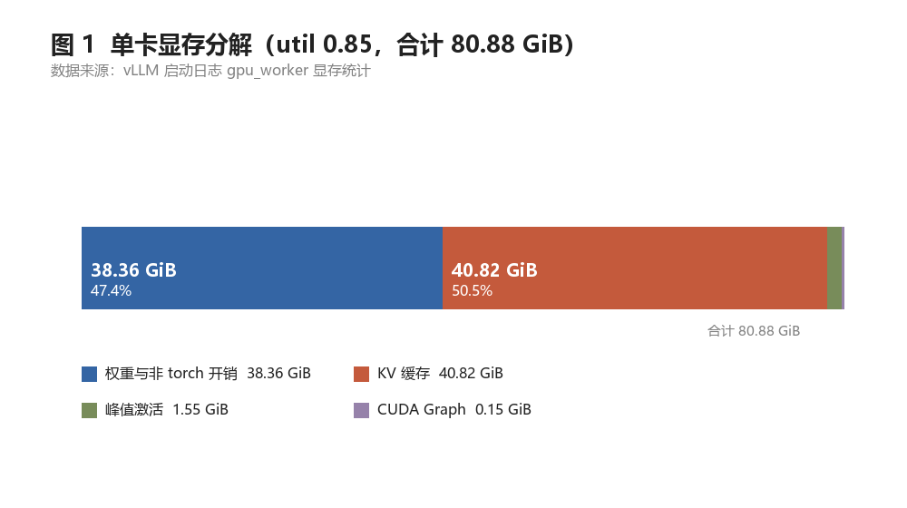
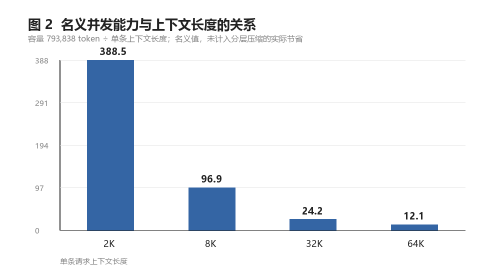
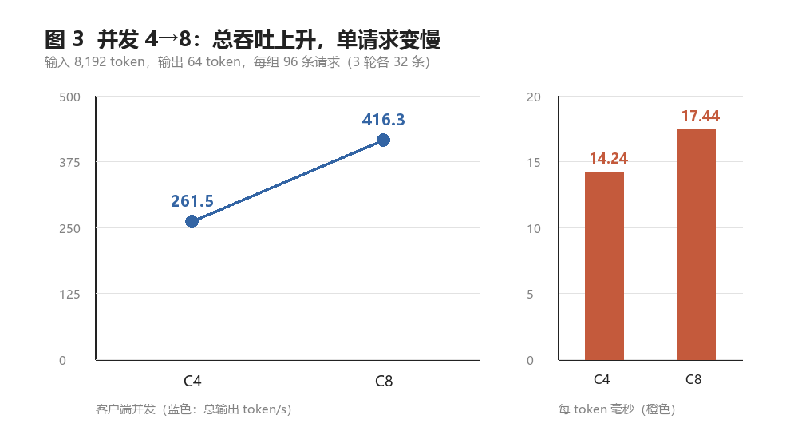
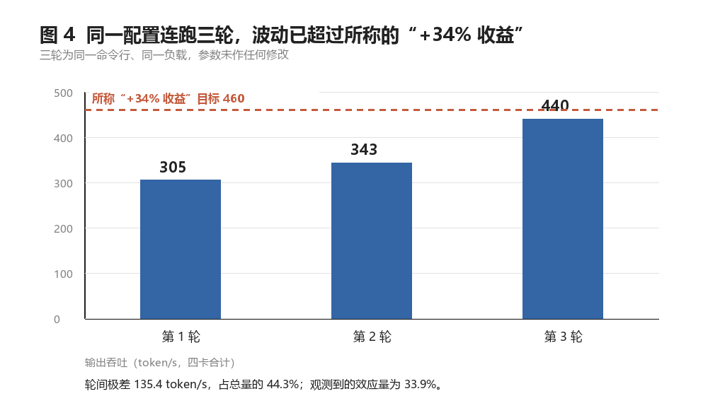
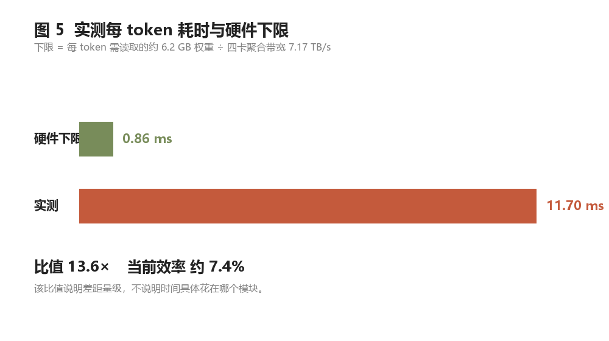

# DeepSeek V4 Flash 0731 推理加速 · 阶段汇报

2026 年 10 月 31 日

---

## 一、本期工作

1. **部署验收**：四卡稳定运行，1,155 条请求零失败，工具调用与思维链解析正常。全程只用 4–7 号卡。
2. **压力测试**：单请求与并发 1/4/8 共 9 档，另加两组参数对照，累计 36 组，每档重复 3 轮。
3. **配置摸底**：权重、显存、缓存容量全部改为启动日志实测，并据此重算效率。

---

## 二、服务配置与容量

表 1 配置与容量（实测）

| 项 | 当前值 |
|---|---|
| 单卡权重 | 37.8 GiB（四卡合计 151 GiB） |
| 单卡显存预算 | 80.88 GiB（利用率 0.85） |
| 单卡 KV 缓存 | 40.82 GiB，可容纳 793,838 token |
| 64K 上下文下的并发能力 | 12.11 路 |
| 权重精度 | 路由专家 4-bit，其余 8-bit |
| KV 缓存精度 | 8-bit |

显存一半给权重、一半给缓存，没有余量。上下文长度与并发数抢的是同一块内存。

并发能力随上下文近似按反比下降。上图为名义值（按每层每 token 完整存储计算），模型对多数层做了分层压缩，实际容量更宽松，但对外应按名义值承诺。

另一条结论：注意力为滑动窗口（128）加稀疏索引（上限 512），计算量在 512 token 后封顶。输入从 2K 增至 8K，每 token 耗时 11.74 → 11.70 毫秒，几乎不变——**上下文变长只增加存储，不增加算力**。

---

## 三、测试结果

表 2 单请求（并发 1，输出 128 token）

| 输入 token | 首字延迟 | 每 token 耗时 | 端到端 | 首字占比 |
|---:|---:|---:|---:|---:|
| 2,052 | 29.28 ms | 11.74 ms | 1.52 s | 1.9% |
| 8,196 | 45.21 ms | 11.70 ms | 1.54 s | 2.9% |

首字占端到端不到 3%，时间几乎全部花在逐 token 生成上。优化重心在 decode，prefill 是次要矛盾。

表 3 并发（输入 8,192 token，输出 64 token，每组 96 条）

| 并发 | 首字延迟 P50 | 每 token 耗时 P50 | 输出吞吐 | 单用户速率 | 每卡吞吐 |
|---:|---:|---:|---:|---:|---:|
| 4 | 69.84 ms | 14.24 ms | 261.53 token/s | 70.2 token/s | 65.4 token/s |
| 8 | 93.74 ms | 17.44 ms | 416.28 token/s | 57.3 token/s | 104.1 token/s |

并发翻倍，总吞吐 +59.2%，单用户速率由 70.2 降至 57.3。收益来自摊薄每步固定开销，但增益明显不线性，8 路已碰到第一道约束。

表 4 参数对照（输入 2,048 token，输出 128 token，并发 8）

| 对照项 | 首字延迟 P50 | 每 token 耗时 P50 | 输出吞吐 | 判定 |
|---|---:|---:|---:|---|
| 服务端并发上限 8（基线） | 202.58 ms | 16.93 ms | 343.48 token/s | — |
| 服务端并发上限 32 | 68.92 ms | 16.86 ms | 460.04 token/s | 不采信 |
| 通信开关：默认 | — | 16.86 ms | 460.04 token/s | — |
| 通信开关：关闭点对点 | — | 17.23 ms | 452.38 token/s | 不可分辨 |

并发上限对照表面 +33.9%，但每 token 只降 0.45%——生成速度没变，改善全在等待阶段。

同一命令行、参数未改，连跑三轮吞吐为 305 / 343 / 440 token/s，极差 135 token/s，占 44.3%。**波动超过待观测的效应量**，该对照不采信。通信开关的 2% 落在噪声内，同样不作结论。

本期未采集 P95 与端到端延迟；9 个并发档位中仅 2 个取得完整三轮有效数据。

---

## 四、性能水平

每生成一个 token 需读取约 6.2 GB 权重，四卡聚合带宽 7.17 TB/s，理论下限 0.86 毫秒；实测 11.7 毫秒，**效率约 7%，相差 13.6 倍**。

差距不是调并发能补的：本期试过的两个参数都落在噪声里。时间具体去向需模块级数据。

---

## 五、问题

**一、压测负载与生产不符。** 全程复用同一段提示词，缓存命中率 99%、缓存使用不足 1%，首字被系统性压低，专家路由过度集中，并发压力没有真正压上去。本轮数字接近最优情况，不代表真实业务水平。

**二、压测系统波动 44%，参数对照不可用。** 三层原因：前两轮分别有 14/32 与 12/32 条请求首字超过 0.5 秒；其中一轮落在内核编译窗口；缓存命中率逐轮走高说明尚未填满。在此波动下做调优，每项收益无法判断真假。

**三、无卡内指标，瓶颈未定位。** 目前只有客户端数据。效率 7% 可以给出，"时间花在哪"无法回答，优化优先级因此无法确定。

---

## 六、下一步

表 5 下一步安排

| 序号 | 动作 | 判断标准 | 预期 |
|---|---|---|---|
| 1 | 启用投机解码（草稿模型，一次提 7 个 token） | 单请求每 token 降至 6 ms 以内 | 约 2 倍提速 |
| 2 | 修正压测负载：每请求独立前缀、逐请求核对命中 | 缓存命中率降至 20% 以下 | 数据可对外比较 |
| 3 | 接入模块级打点 | 拆分计算、通信、调度占比 | 定优化优先级 |
| 4 | 按打点结果定点优化 | 改动前后同口径对比 | 待定 |

第一步依据：同型号四卡启用该方案后单请求约 6 ms/token，为当前两倍，且是本期已知唯一的显著配置差异。验证成本低，收益上限高。

硬判据：若降不到 10 ms 以内，说明该方案不是主因，立即停止后续对照，转而先补问题一与问题三。
